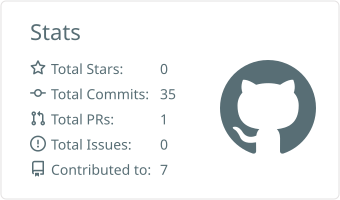
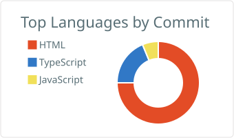

<!-- ===================== CABEÇALHO ===================== -->
<h1 align="center">Arthur Neves</h1>

  <b>Engenharia de Software · Backend & Mobile · Qualidade de Software</b> 
  Manaus, AM · Aberto a oportunidades de estágio

  
  

<!-- ===================== SOBRE MIM ===================== -->
## 👋 Sobre mim

- 🎓 Estudante de **Engenharia de Software** no Centro Universitário FAMETRO (conclusão prevista em 2028).
- 🚀 Desenvolvo o **Study Flow**, um app Android para aprender vocabulário em inglês com IA, hoje em **beta fechado**. Cuido do app, da API, do banco e do servidor.
- 🧪 Gosto de software que se prova: testes automatizados, técnicas de caixa-preta (partição por equivalência e valor-limite), requisitos documentados e rastreabilidade.
- 🐧 Publico o que construo: servidor Linux, Docker Compose e HTTPS com Caddy.
- 🌎 Inglês intermediário (B1 – EF SET).

<!-- ===================== PROJETO PRINCIPAL ===================== -->
## 🚀 Em destaque: Study Flow

App Android que transforma **textos, PDFs e fotos** em cartões de vocabulário em inglês com IA e agenda as revisões no momento certo. Produto que estou criando do zero: **app, API, banco de dados e deploy**.

<table>
<tr>
<td width="33%" valign="top">

**🤖 IA no servidor** 
Gemini chamado só pela API, com limites de uso e custo por usuário

</td>
<td width="33%" valign="top">

**📸 Importação inteligente** 
Texto, PDF ou foto; a IA avisa se a imagem está desfocada ou escura

</td>
<td width="33%" valign="top">

**🧠 Revisão espaçada** 
Algoritmo FSRS decide quando cada palavra deve voltar

</td>
</tr>
<tr>
<td width="33%" valign="top">

**🔐 Contas e privacidade** 
Login por e-mail ou Google e registro de aceites (LGPD)

</td>
<td width="33%" valign="top">

**🐳 Deploy próprio** 
Servidor Linux próprio com Docker Compose, HTTPS e monitoramento de uso e custos

</td>
<td width="33%" valign="top">

**🧪 Qualidade** 
Testes automatizados, testes de fumaça da API e decisões documentadas (ADRs)

</td>
</tr>
</table>

<b>Ver arquitetura completa e experimento com IA local</b>

 

| Camada | O que eu construí |
| --- | --- |
| **App** | React Native (Expo) + TypeScript |
| **API** | REST em Hono (Node.js), PostgreSQL com Drizzle ORM, validação com Zod, login por e-mail/senha e Google (Better Auth) |
| **IA** | Google Gemini chamado só pelo servidor, com limites de uso e custo e registro de cada chamada |
| **Importação** | Texto, PDF e foto; a foto passa por IA multimodal que também avalia a qualidade da imagem |
| **Estudo** | Revisão espaçada com o algoritmo FSRS |
| **Infra** | Servidor Linux em nuvem, Docker Compose, HTTPS com Caddy e painel interno de uso e custos |
| **Qualidade** | Testes automatizados das regras de correção, testes de fumaça da API, ADRs, SDD, revisão de segurança e registro de aceites (LGPD) |

**Experimento:** comparei um modelo local (qwen3:8b via Ollama) com o Gemini 3.5 Flash-Lite em 62 casos rotulados: 85% × 78% de aprovação e tempo mediano de 1,6 s × 3,9 s. O experimento ficou num ramo separado e não foi para produção.

<!-- ===================== OUTROS PROJETOS ===================== -->
## 📂 Outros projetos

| Projeto | Sobre | Minha parte | Stack |
| --- | --- | --- | --- |
| [**TrayCheck**](https://github.com/GustavoPaes20/TrayCheck) | Conferência de kits cirúrgicos, estoque e divergências (projeto acadêmico em equipe) | Modelei o banco MySQL: 5 migrações versionadas, gatilhos que garantem as regras de negócio, dados de demonstração e 70 verificações automatizadas; DER gerado por script; ERS, matriz de rastreabilidade e controle de itens de configuração | MySQL · SQL · Shell · Python |
| [**Avisa Manaus**](https://github.com/ArthurRN/ProjetoAvisaManausSite) | Denúncias georreferenciadas de problemas urbanos (Web + [Mobile](https://github.com/ArthurRN/AvisaManaus-Mobile)) | Um dos idealizadores; fiz o protótipo e a versão Web e programei junto com a equipe o app mobile | Node.js · Express · MongoDB · Google Maps API · React Native |
| [**Lab de Testes: Taxa de Entrega**](https://github.com/ArthurRN/Lab-teste-entrega-1408) | Teste de caixa-preta de uma regra de cálculo de frete | 13 casos de teste (partição por equivalência + valor-limite) seguindo a ISO/IEC/IEEE 29119-4, automatizados com Jest e relatório HTML | JavaScript · Jest |
| [**CorBot**](https://github.com/Cesar-Queiroz/inovatech25-) | Plataforma web educativa para crianças daltônicas | Interface e desafios interativos com foco em acessibilidade | HTML · CSS · JavaScript · Node.js |

<!--
  ECOLIZE: preencha "Minha parte" e cole a linha dentro da tabela acima.
| [**Ecolize**](https://github.com/GustavoPaes20/ecolize) | App de monitoramento de energia e água com sensores ESP32 | <SUA PARTE AQUI> | Expo · React Native · Node.js · MySQL |
-->

<!-- ===================== STACK ===================== -->
## 🛠️ Stack

  
   
  
   
  

**Também uso:** Expo · Hono · Drizzle ORM · Zod · Jest · Caddy · Trello (Kanban) 
**Estudando agora:** Teste de software (base ISTQB) · Python · Power BI

<!-- ===================== ESTATÍSTICAS ===================== -->
## 📊 Estatísticas do GitHub

  <picture>
    <source media="(prefers-color-scheme: dark)" srcset="./profile-summary-card-output/github_dark/3-stats.svg">
    
  </picture>
  <picture>
    <source media="(prefers-color-scheme: dark)" srcset="./profile-summary-card-output/github_dark/2-most-commit-language.svg">
    
  </picture>

  <picture>
    <source media="(prefers-color-scheme: dark)" srcset="https://streak-stats.demolab.com?user=ArthurRN&hide_border=true&locale=pt_BR&theme=github-dark-blue">
    
  </picture>

<!-- ===================== COBRINHA (gerada pelo GitHub Actions) ===================== -->
## 🐍 Contribuições em movimento

<picture>
  <source media="(prefers-color-scheme: dark)" srcset="https://raw.githubusercontent.com/ArthurRN/ArthurRN/output/github-contribution-grid-snake-dark.svg">
  
</picture>
